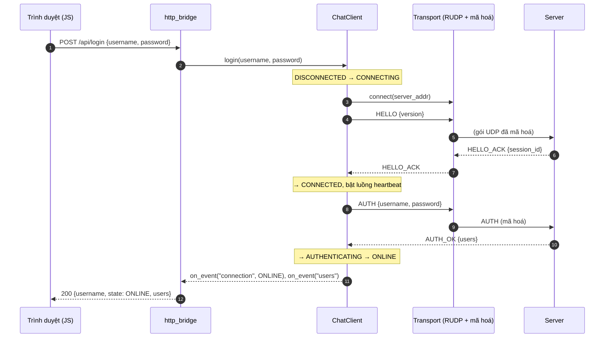
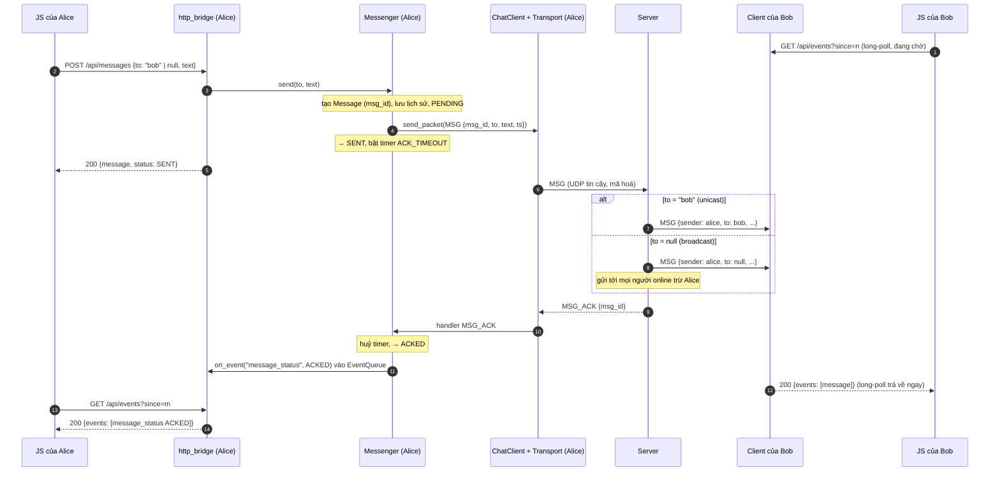
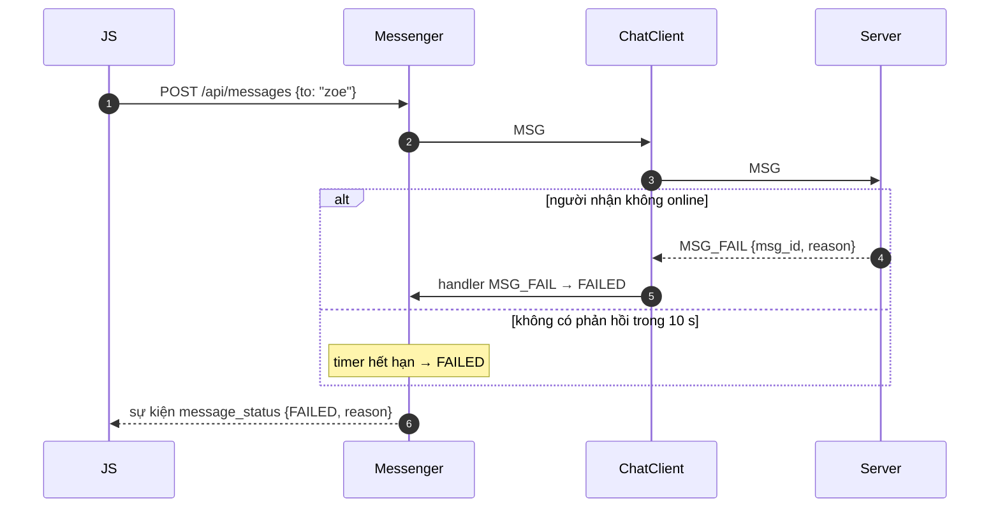
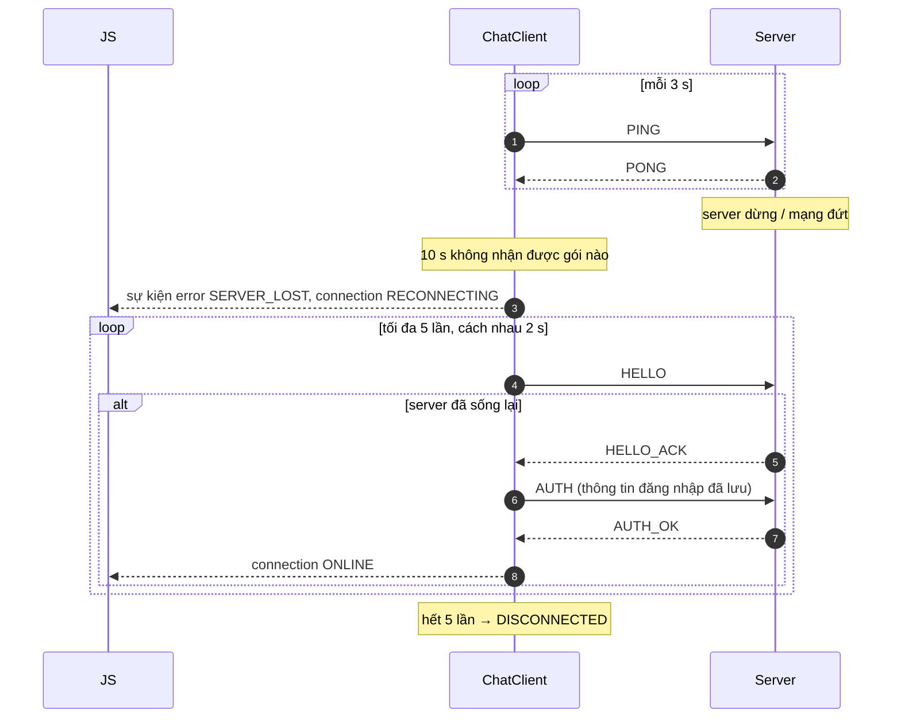

# Sơ đồ tuần tự — phía client

Vẽ bằng Mermaid (GitHub hiển thị trực tiếp; xuất ảnh cho báo cáo bằng https://mermaid.live).
Tên packet theo docs/api.md §6.2. Phần "Transport" là reliable_udp + mã hoá (⏳ của nhóm),
ở đây gộp thành một khối.

## 1. Đăng nhập

## 2. Gửi tin nhắn (tin chung và tin riêng)

## 3. Gửi tin thất bại

## 4. Mất kết nối và tự kết nối lại

