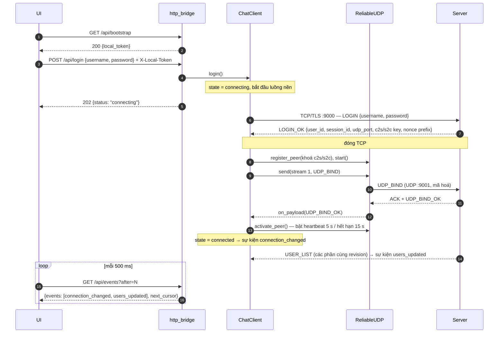
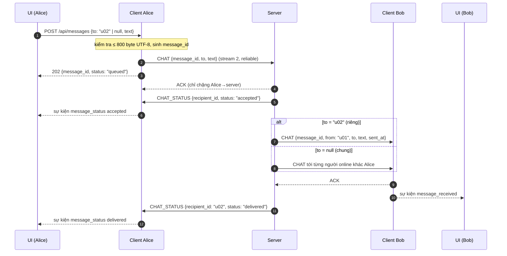
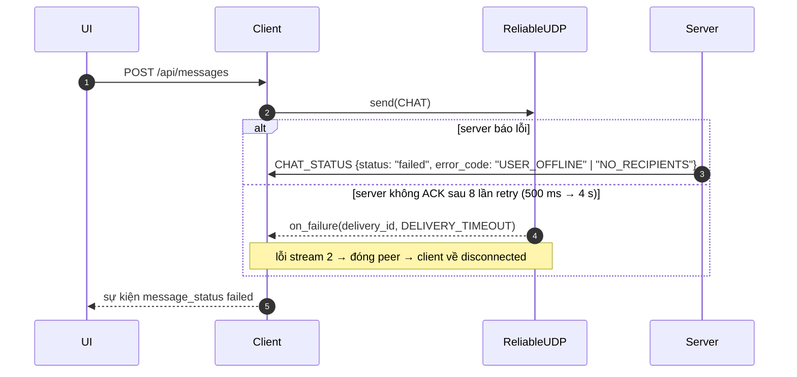
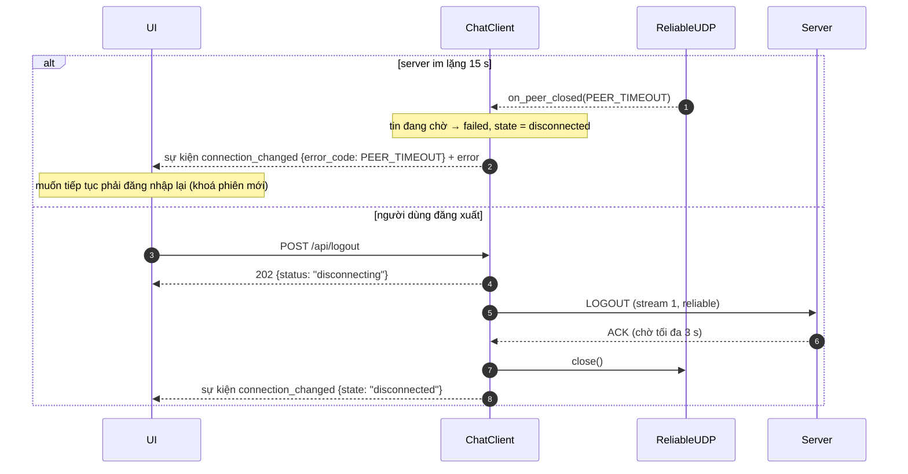
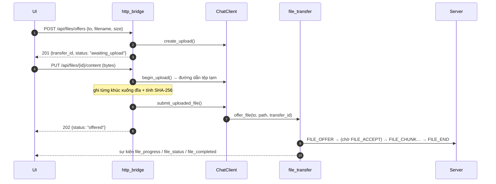

# Sơ đồ tuần tự — phía client

Vẽ bằng Mermaid (GitHub hiển thị trực tiếp; xuất ảnh cho báo cáo bằng https://mermaid.live).
Theo [1a_api.md](../1a_api.md) và [1b_protocol_spec.md](../1b_protocol_spec.md).

- **UI**: JavaScript trên trình duyệt (người 5).
- **HB**: `http_bridge.py`. **CL**: `ChatClient` + `Messenger` (`client.py`, `messaging.py`).
- **RU**: `ReliableUDP` (`reliable_udp.py`, mã hoá AES-GCM trong `protocol.py`).
- **SV**: server (`server.py`, `sessions.py`).

## 1. Đăng nhập



Nếu sai mật khẩu (`ERROR INVALID_CREDENTIALS`), lỗi TLS hoặc không nhận được `UDP_BIND_OK`
trong 10 giây, thì client quay về `disconnected` và phát `connection_changed` + `error`.

## 2. Gửi tin nhắn (riêng và chung)



Tin chung có `CHAT_STATUS` riêng cho từng người nhận. `delivered` nghĩa là client đích đã
ACK gói CHAT, không có nghĩa người dùng đã đọc.

## 3. Gửi tin thất bại



## 4. Mất kết nối và đăng xuất



## 5. Gửi tệp (phần client; ⏳ chi tiết FILE_* do file_transfer.py)



## Ghi chú: `begin_upload` và `abort_upload`

Đây là **hai hàm Python nội bộ** trong facade `client.py`, bổ sung so với danh sách ở
`1a_api.md` §5.

```python
begin_upload(transfer_id: str, content_length: int) -> str   # trả đường dẫn tệp tạm
abort_upload(transfer_id: str, error_code: str) -> None
```

| Hàm | Khi nào bridge gọi | Làm gì |
|---|---|---|
| `begin_upload` | Nhận `PUT /api/files/{id}/content`, **trước** khi đọc body | Kiểm tra offer tồn tại, chưa hết hạn 60 giây, đang `awaiting_upload`, `Content-Length` đúng `size`; đánh dấu đang upload; trả đường dẫn tệp tạm |
| `abort_upload` | Upload hoặc `submit_uploaded_file` bị lỗi | Xoá offer và tệp tạm, phát sự kiện `file_status` với `status: "failed"`. Gọi nhiều lần không sao. |

Lý do cần thêm (chỉ dùng `list_transfers()` thì không đủ):

1. **Hai PUT cùng lúc cho một `transfer_id`**: `begin_upload` kiểm tra và đánh dấu trong
   cùng một lần khoá, nên request thứ hai nhận 409 `INVALID_STATE` thay vì cả hai cùng ghi tệp.
2. **Upload lỗi phải "dọn tệp tạm và đánh dấu failed"** (`1a_api.md`, PUT content): trạng
   thái offer nằm trong client, bridge không tự đánh dấu hay phát sự kiện được.

Lỗi `begin_upload` có thể trả: 404 `TRANSFER_NOT_FOUND`, 409 `INVALID_STATE`,
400 `INVALID_INPUT` (size không khớp), 501 `NOT_IMPLEMENTED` (chưa có file_transfer.py).
